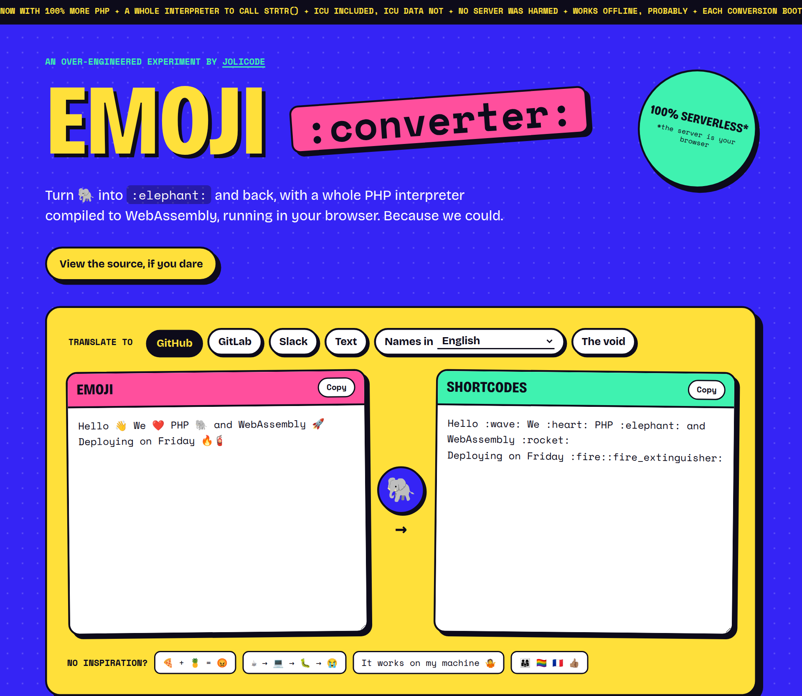
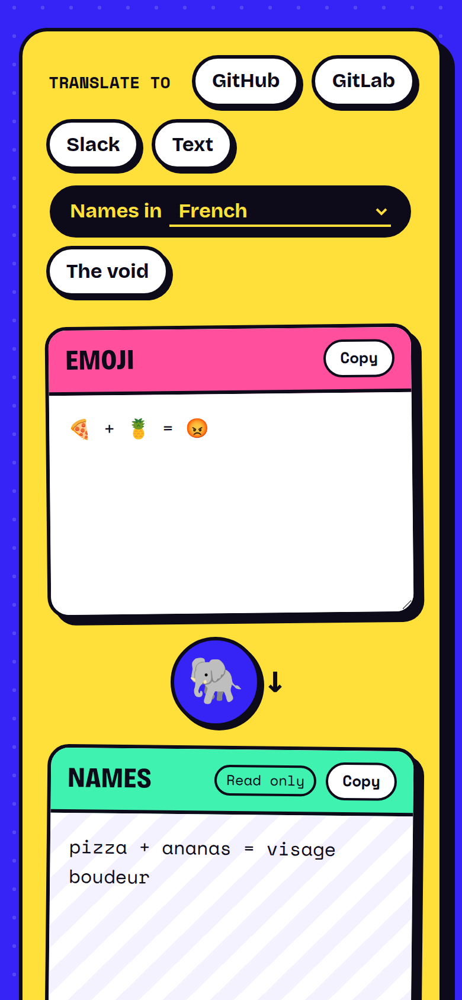
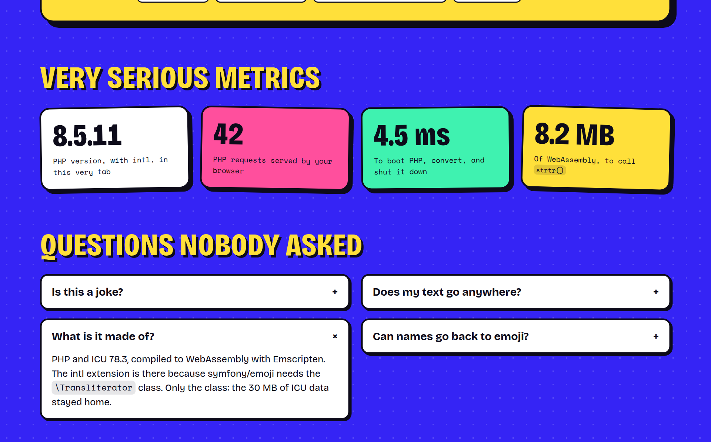

# Emoji Converter

> Turn 🐘 into `:elephant:` and back, with a whole PHP interpreter compiled to
> WebAssembly, running in your browser. Because we could.

**[Try it online](https://jolicode.github.io/emoji-converter/)**



Emoji Converter converts emoji to shortcodes (GitHub, GitLab, Slack, text), to
their names in 136 languages, or to nothing at all, and shortcodes back to
emoji. The conversion is done by [symfony/emoji](https://symfony.com/doc/current/emoji.html),
in PHP, in your browser: there is no server, your text never leaves the tab.

<p align="center">
    
</p>

## Is this a joke?

Mostly. symfony/emoji converts with a good old `strtr()`, and we ship 8 MB of
WebAssembly to call it. But it works, it is fast (a few milliseconds per
conversion, PHP boot included), and it was a good excuse to build PHP with the
intl extension for the browser, which is the actually hard part.



## How it works

The [Dockerfile](website/Dockerfile) builds everything in `website/public/build/`:

* `php-web.wasm` and `php-web.mjs`: PHP 8.5 with the intl extension, compiled
  with Emscripten. ICU is statically linked, so there is no `intl.so` to load
  with `dlopen()`: it compiles WebAssembly synchronously, which Chrome refuses
  on the main thread;
* `php-web.data`: the application (`src/`, `website/src/` and `vendor/`),
  mounted in `/app`;
* `emoji/`: the catalogs of symfony/emoji. They weigh ~37 MB, so the page only
  fetches the ones it needs (see [php.js](website/public/js/php.js)).

The ICU data (~30 MB) is not shipped: symfony/emoji only needs the
`\Transliterator` class. Anything else that needs the ICU data (`Collator`,
`NumberFormatter`, `IntlDateFormatter`…) fails.

For each conversion, the page writes the request in `/tmp/request.json`, runs
[`website/src/convert.php`](website/src/convert.php), and reads the result in
`/tmp/response.txt`. PHP is started and shut down on each conversion, see
[phpw.c](website/phpw.c).

Fibers and `proc_open()` are not supported: Emscripten does not provide the
functions they rely on.

## Use it in PHP

The converter is a thin layer over symfony/emoji:

```php
use EmojiConverter\EmojiConverter;

$converter = new EmojiConverter();

$converter->fromEmoji('github', 'Hello 👋 🐘'); // Hello :wave: :elephant:
$converter->fromEmoji('fr', 'Hello 👋 🐘'); // Hello signe de la main éléphant
$converter->toEmoji('slack', 'Hello :wave: :elephant:'); // Hello 👋 🐘
```

Only the shortcode catalogs (`github`, `gitlab`, `slack`, `text`) can convert
back to emoji.

## Development

You need PHP 8.4+ with intl, Composer, [Castor](https://castor.jolicode.com/),
and Docker with Buildx.

```bash
castor install        # Install the dependencies
castor tests          # Run the tests
castor website:build  # Build PHP WebAssembly with the application
castor website:serve  # Serve the website on http://localhost:9999
```

The first build takes a few minutes (ICU and PHP are compiled), then only the
application is packed again. The website is deployed on GitHub Pages on each
push on `main`.

## License

Emoji Converter is released under the MIT license, see [LICENSE](LICENSE). The
fonts, Bricolage Grotesque and Space Mono, are released under the SIL Open Font
License.

<br><br>
<div align="center">
<a href="https://jolicode.com/"></a>
</div>
